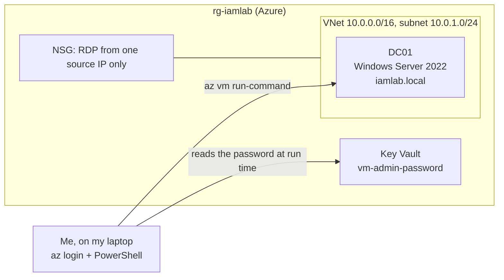

# Identity Lifecycle Lab: Joiners, Movers, Leavers and Audit on Active Directory

One domain controller, twenty users, and the full account lifecycle: create them, move them between departments, disable them when they leave, and audit the whole directory against least privilege. Every step is a PowerShell script that runs on the domain controller from outside, with a dry-run switch on anything that changes accounts.

This is Lab 4 of my Azure series: **NTFS File Server, RBAC, Azure Update Manager, then this identity lab.** The earlier labs controlled access to data and to servers. This one controls the thing underneath both: who exists in the directory, what they belong to, and whether anyone can prove it.

## Why this lab

An account is a decision someone made. Someone approved it, someone put it in a group, and someone should have removed it when the person left. In practice the paperwork and the directory drift apart: a leaver stays enabled, a mover keeps the old department's access, a service account ends up in Domain Admins because it was convenient.

This lab builds the process that stops the drift and the check that catches it anyway.

- **Joiner:** accounts are created from a list with a ticket number written into the account's Description.
- **Mover:** a transfer swaps the department group, updates the title and moves the account to the new OU (organizational unit), all under one ticket.
- **Leaver:** the account is disabled first, never deleted, stripped of groups and moved to a Disabled OU.
- **Audit:** a read-only script checks the directory against NIST SP 800-53 AC-2 (account management) and AC-6 (least privilege).

## Architecture



Scripts never open a remote desktop session. `az vm run-command` pushes each script to DC01 and returns the output, so the same script runs the same way every time.

The directory itself:

```
iamlab.local
├── OU=Staff
│   └── OU=Finance   OU=HR   OU=IT   OU=Operations
├── OU=Groups          SG-Finance, SG-HR, SG-IT, SG-Operations
├── OU=Disabled        leavers land here
└── OU=Workstations    computer policy applies here
```

## What's inside

```
iam-lab-terraform/
├── backend.tf                  ← remote state, its own state key (iam-lab.tfstate)
├── versions.tf                 ← Terraform 1.5 or later, azurerm ~> 3.100
├── main.tf / variables.tf / outputs.tf
├── modules/
│   ├── networking/             ← VNet, subnet, NSG
│   ├── keyvault/               ← vault, admin password secret
│   └── compute/                ← DC01 only
├── terraform.tfvars.example    ← copy to terraform.tfvars (gitignored)
└── scripts/
    ├── 00-promote-dc.ps1       ← DC01 becomes the domain controller for iamlab.local
    ├── 10-create-structure.ps1 ← OUs and security groups
    ├── 11-onboard-users.ps1    ← 20 users, random passwords, ticket in Description
    ├── 12-ldap-queries.ps1     ← search by department, title, group
    ├── 13-password-policy.ps1  ← baseline policy + fine-grained policy for IT
    ├── 14-workstation-gpo.ps1  ← computer security baseline
    ├── 15-user-restrictions-gpo.ps1
    ├── 16-audit-policy.ps1     ← what the Security log records
    ├── 17-read-security-events.ps1
    ├── 18-leaver-offboarding.ps1
    ├── 19-mover.ps1
    └── 20-user-audit.ps1       ← read-only least-privilege check
```

## Design decisions

**Passwords.** The 20 users get random passwords that are never printed or saved. The domain admin password lives in Key Vault only and is read into an environment variable at run time. Nothing secret is committed.

**Password policy.** Baseline for everyone: 12 characters, 24 passwords of history, 90-day maximum age, lockout after 5 attempts. IT gets a fine-grained password policy (PSO, Password Settings Object) attached to `SG-IT`: 16 characters, lockout after 3. A PSO attaches to a user or a global security group, not to an OU, which is why the department groups exist.

**Group Policy.** A GPO (Group Policy Object) applies where it is linked.

| GPO | Linked to | Does |
|---|---|---|
| Workstation security baseline | Workstations OU | Blocks removable storage, 15-minute inactivity lock, no forced reboot over a signed-in user |
| Standard user restrictions | Finance, HR, Operations | Blocks `cmd` and the PowerShell executables |

IT is left out of the restrictions on purpose. Computer settings follow the computer and user settings follow the user, so the USB block does not follow a mover to a new department. I tested exactly that.

**Auditing.** The DC records account creation, enabling, password reset, disabling, deletion and lockout (event IDs 4720, 4722, 4724, 4725, 4726, 4740). In this lab the "By" column shows `DC01$`, because run-command runs as SYSTEM. A real environment with named admin accounts would show a person.

**Disable first, delete later.** Leavers are disabled, emptied of groups, tagged with a ticket and kept in the Disabled OU. Deleting is a separate, later decision.

## Deploying it

Prerequisites: Azure CLI, Terraform 1.5 or later, PowerShell, and a storage account for remote state.

```powershell
az login

Copy-Item terraform.tfvars.example terraform.tfvars   # fill in your values

# Password for the VM: typed once, never written to a file
$secure = Read-Host "Admin password" -AsSecureString
$env:TF_VAR_admin_password = [System.Net.NetworkCredential]::new('', $secure).Password

terraform init
terraform plan -out lab.tfplan
terraform apply lab.tfplan
Remove-Item lab.tfplan
```

Then run the scripts in numeric order with the helper from my scripts repo:

```powershell
. .\common\lab-commands.ps1
Set-Lab -ResourceGroup rg-iamlab -VM DC01
Import-LabPassword -VaultName <vault>
Invoke-Lab -ScriptFile .\scripts\00-promote-dc.ps1
```

Stop the lab with `Stop-Lab` (deallocate). A stopped VM still bills for compute. A deallocated one does not, though its disk still costs a little.

## Verification

### Do the lifecycle scripts do what they say?

Each script that changes accounts ships with `$dryRun = $true`. The dry run prints what it would do, then I flip the switch.

- **Leaver:** the dry run said it would disable two accounts and remove one group each. The real run did it. The Security log then showed two new 4725 (account disabled) events at the top, and the directory showed both accounts disabled, in the Disabled OU, with no group memberships and a Description reading "Leaver ticket ... Was: Joiner ticket ...".
- **Mover:** one Finance user moved to IT. After the run: department and title updated, member of `SG-IT` only, in `OU=IT`, Description carrying the mover ticket, and the IT fine-grained policy now the one that applies to him (checked with `Get-ADUserResultantPasswordPolicy`).

### Does the audit catch real problems?

`20-user-audit.ps1` is read-only. It checks:

- Password never expires, and members of privileged groups who are not on an approved list
- Department group matches the OU, and no membership in another department's group
- Missing title or department, and no ticket in the Description
- Never signed in, or stale, accounts
- Enabled accounts in the Disabled OU, and disabled accounts outside it
- Empty groups, and accounts left in the default `Users` container

On the first run it flagged several accounts, including `labadmin` as an unapproved privileged member. That one was my own config, not a planted problem: the approved list only named `Administrator`. I added `labadmin` after deciding it was legitimate, cleaned up the rest and re-ran to `Findings: 0`.

One setting is worth knowing about: `LastLogonTimestamp` replicates with up to a 14-day delay, so a stale threshold below about 14 days produces false alarms.

### Can a deleted account come back?

The AD Recycle Bin is **off by default**. I confirmed that, then enabled it. Enabling is irreversible and forest-wide, which in production is a decision for a change ticket.

Test: I created `testrestore`, deleted it, confirmed it sat in `CN=Deleted Objects`, and ran `Restore-ADObject`. The SID (security identifier) came back identical, which is the point. Re-creating an account gives a new SID, a different identity with none of the old one's access or history. It also returned to `CN=Users`, not the Disabled OU I expected, because `LastKnownParent` records where the object was when it was deleted.

## Backup and recovery: a runbook, not a proven procedure

I walked through full DC recovery as a read-only exercise: system state backup with `wbadmin`, Directory Services Restore Mode, non-authoritative versus authoritative restore with `ntdsutil` (the 100,000 version bump), the 180-day tombstone lifetime, USN rollback (never roll back a DC with a VM snapshot), and RPO and RTO. I did **not** perform a restore on this lab. The only recovery I proved hands-on is the Recycle Bin test above.

The point I had wrong at first: a non-authoritative restore alone does not bring a deleted user back, because replication from the other DCs re-applies the delete.

## What broke

**`terraform validate` said "Module not installed."** `main.tf` still pointed at `./modules/networking`, `keyvault` and `compute`, but the local `modules` folder had gone from the project. I don't know what removed it, and I haven't guessed. The deployed lab was untouched, since state lives in remote storage. I restored the three modules from the sibling lab, cut the server list in `compute` down to DC01 only (the source lab builds three servers, so the first plan would have added two I never wanted), and ran `terraform init`. The check that proved it: `terraform plan` showed **0 to add, 1 to change, 0 to destroy**, the one change being an Azure agent platform setting on the VM, updated in place. I did not apply it.

**run-command quirks that cost time:**

- `$` inside double-quoted inline strings expands on my laptop before it reaches the server. Use single quotes or a script file.
- `az` on Windows strips quotes and fails on parentheses in `--query` ("was unexpected at this time"). Simpler query shapes work.
- Table output comes back empty unless piped through `Out-String`.
- A script with a mandatory parameter hangs run-command: it can't prompt, so it waits until it times out.

## Known loose ends

- Resource names still carry an `aumlab` prefix from the lab this was cloned from. Cosmetic, but I'd rename them in the next clone.
- The audit's privileged-group approval list is a config line, and it needs a human to own it.

## What I took from this

Building the scripts was the easy part. What taught me something was the gap between "the script said success" and "the directory is actually right." The leaver script said it worked, and I still read the Security log and the account's attributes to confirm. The audit flagged my own admin account as a finding, which is exactly what an audit should do to its author.

The restore tests were the best lesson. A recreated account looks the same on screen and is a different identity underneath. Knowing why is what separates "I can click restore" from "I can explain a recovery to someone who has to sign off on it."

I'd extend this with group-change events (4728, 4729, 4738), which the event reader doesn't parse yet, and an actual restore from a system state backup in a throwaway copy of the lab.
